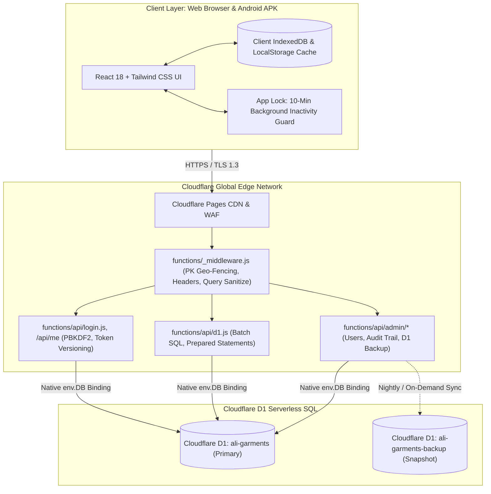

# ALI Garments — Smart Khata & Enterprise ERP Portal

[](https://ali-garments.pages.dev)
[](https://ali-garments.pages.dev)
[](https://ali-garments.pages.dev)
[-green?logo=android)](https://ali-garments.pages.dev)

> **Enterprise-Grade Khata, Commercial Billing & Multi-User Ledger System**  
> Deployed on **Cloudflare Pages Global Edge** with native **Cloudflare D1 SQLite** persistence, **PBKDF2 Web Crypto** authentication, **Pakistan Geo-Fencing**, and offline-first **Capacitor Android PWA** packaging.  
> *Developed for ALI Garments • Designed & Engineered by Chengdu Shuze International*

---

## 📑 Table of Contents
1. [System Architecture](#-system-architecture)
2. [Key Capabilities & Features](#-key-capabilities--features)
3. [Cybersecurity & Zero-Trust Defense](#-cybersecurity--zero-trust-defense)
4. [D1 Single-Row Chunking & Sync Engine](#-d1-single-row-chunking--sync-engine)
5. [Complete D1 Database Schema](#-complete-d1-database-schema)
6. [Local Setup & Deployment](#-local-setup--deployment)
7. [Android APK Generation & Signing](#-android-apk-generation--signing)
8. [Admin User Management & Audit Logging](#-admin-user-management--audit-logging)

---

## 🏛️ System Architecture

ALI Garments is architected as an edge-native, zero-trust progressive web application and Android app:



---

## ✨ Key Capabilities & Features

### 1. Wholesale & Retail Customer Khata
- **Multi-Balance Tracking:** Real-time calculation of receivables (*Lene Hain*), payables (*Dene Hain*), and cleared (*Settled*) ledgers.
- **Deep Search & Filters:** Fast, safe filtering across customer names, phone numbers, addresses, markets, bill numbers, and payment modes.
- **WhatsApp Direct Sharing:** Generate formatted Urdu/English ledger bills sent directly to client WhatsApp numbers with a single click.
- **Commercial Invoicing:** Create, customize, and print formal tax invoices with itemized tables, discounts, and payment terms.
- **Excel (.xlsx) Export:** Full client balance sheet and transaction ledger download powered by client-side Excel libraries.

### 2. High-Performance Offline-First Sync
- **Sub-100ms Load:** Immediate application startup rendering cached IndexedDB customer data, followed by silent edge reconciliation.
- **Automatic Background Synchronization:** On initial login or connectivity recovery, the app syncs all customer ledgers automatically from Cloudflare D1.
- **Multi-Device Conflict-Free Sync:** High-watermark chunk timestamps prevent race conditions across desktop and mobile devices.

### 3. Enterprise Recycle Bin
- **30-Day Multi-Device Synchronized Trash:** Soft-deletes customers and transactions with an automated 30-day retention window.
- **Accidental Deletion Safeguards:** Modal confirmation and easy one-click restoration to prevent data loss.

### 4. Modern UX & Security Usability
- **Smooth Theme Transition:** Zero-flicker animated switching between Dark and Light mode powered by global CSS variables.
- **App Lock with Background Timer:** Biometric/PIN App Lock keeps the app unlocked indefinitely while active in the foreground, but automatically locks if the browser tab is hidden or backgrounded for more than 10 minutes.
- **Crash-Proof React Error Boundary:** Top-level error boundaries trap unexpected runtime exceptions, providing recovery options instead of a blank white screen.

---

## 🛡️ Cybersecurity & Zero-Trust Defense

The application has been audited against **OWASP Top 10 (2021)** and **OWASP API Security Top 10 (2023)** standards:

| Security Vector | Implementation Detail | Status |
| :--- | :--- | :--- |
| **Password Storage** | Web Crypto `PBKDF2` with `SHA-256`, 100,000 iterations, unique 16-byte cryptographically secure salts. **Zero plaintext passwords stored.** | ✅ Active |
| **Brute-Force Shield** | Persistent D1 rate-limiting in `login_attempts` table (3 failed attempts within 15 minutes triggers an edge lockout). | ✅ Active |
| **Session Invalidation** | HMAC-SHA256 edge-signed session tokens tied to `token_version`. Suspending an account or changing credentials revokes all active sessions immediately. | ✅ Active |
| **Pakistan Geo-Fencing** | All API traffic is restricted to Pakistan (`request.cf?.country === 'PK'`). Foreign IP requests are blocked with `403 Forbidden` and recorded in `audit_logs`. | ✅ Active |
| **Foreign Access Override**| Super Admins can toggle `allow_foreign_access` for individual users (e.g. travelers or overseas managers) in the Admin Console. | ✅ Active |
| **Edge Security Headers** | Injected via `_middleware.js`: `Strict-Transport-Security`, `X-Content-Type-Options: nosniff`, `X-Frame-Options: SAMEORIGIN`, and strict CORS. | ✅ Active |
| **Audit Trail** | Every login, failed attempt, user creation, role modification, suspension, and foreign block is immutably logged with IP and User Agent. | ✅ Active |

---

## ⚡ D1 Single-Row Chunking & Sync Engine

Cloudflare D1 is SQLite at the edge. To avoid hitting D1 query limits when managing 132+ wholesale parties and tens of thousands of transactions:
1. **Metadata in `customers`:** Customer ID, name, phone, address, balance, and transaction count are stored in standard columns for fast indexed queries.
2. **Transactions in `customer_chunks`:** Customer transactions are grouped into compact JSON chunks (1 chunk per customer row, automatically spanning if exceeding SQLite row size limits).
3. **99% Quota Reduction:** Instead of reading thousands of individual transaction rows per sync, D1 reads only 1 chunk row per customer, staying well within Cloudflare free and paid D1 limits.
4. **Batch SQL Support:** `functions/api/d1.js` executes batch queries using Cloudflare D1's native `env.DB.batch(stmts)` for transactional atomicity.

---

## 🗄️ Complete D1 Database Schema

Execute this schema in your Cloudflare D1 database:

```sql
-- 1. Users Table (Zero Plaintext Passwords, Token Versioning, Foreign Access Control)
CREATE TABLE IF NOT EXISTS users (
    id INTEGER PRIMARY KEY AUTOINCREMENT,
    name TEXT NOT NULL,
    email TEXT UNIQUE NOT NULL,
    password_hash TEXT NOT NULL,
    role TEXT DEFAULT 'user', -- 'super_admin', 'admin', 'user'
    status TEXT DEFAULT 'active', -- 'active', 'suspended'
    suspension_reason TEXT,
    allow_foreign_access INTEGER DEFAULT 0, -- 1: allow non-PK access
    token_version INTEGER DEFAULT 1, -- Incremented on password change/suspension to revoke tokens
    last_login_at DATETIME,
    last_login_ip TEXT,
    last_active_at DATETIME,
    created_at DATETIME DEFAULT CURRENT_TIMESTAMP,
    updated_at DATETIME DEFAULT CURRENT_TIMESTAMP
);

-- 2. Brute-Force Rate Limiting Table
CREATE TABLE IF NOT EXISTS login_attempts (
    id INTEGER PRIMARY KEY AUTOINCREMENT,
    ip TEXT NOT NULL,
    email TEXT,
    attempted_at DATETIME DEFAULT CURRENT_TIMESTAMP,
    success INTEGER DEFAULT 0
);
CREATE INDEX IF NOT EXISTS idx_login_attempts_ip_time ON login_attempts(ip, attempted_at);

-- 3. Audit Trail Table
CREATE TABLE IF NOT EXISTS audit_logs (
    id INTEGER PRIMARY KEY AUTOINCREMENT,
    user_id INTEGER,
    user_email TEXT,
    action TEXT NOT NULL,
    details TEXT,
    ip TEXT,
    user_agent TEXT,
    created_at DATETIME DEFAULT CURRENT_TIMESTAMP
);
CREATE INDEX IF NOT EXISTS idx_audit_logs_created_at ON audit_logs(created_at DESC);

-- 4. Wholesale Customers Table
CREATE TABLE IF NOT EXISTS customers (
    customer_id TEXT PRIMARY KEY,
    name TEXT NOT NULL,
    phone TEXT,
    address TEXT,
    category TEXT DEFAULT 'customer',
    balance REAL DEFAULT 0.0,
    current_chunk INTEGER DEFAULT 0,
    total_transactions INTEGER DEFAULT 0,
    created_at TEXT NOT NULL,
    updated_at TEXT NOT NULL
);

-- 5. Customer Transaction Chunks (1 Row per Customer)
CREATE TABLE IF NOT EXISTS customer_chunks (
    customer_id TEXT NOT NULL,
    chunk_index INTEGER NOT NULL DEFAULT 0,
    transactions_json TEXT NOT NULL DEFAULT '[]',
    byte_size INTEGER DEFAULT 0,
    count INTEGER DEFAULT 0,
    updated_at TEXT NOT NULL,
    PRIMARY KEY (customer_id, chunk_index),
    FOREIGN KEY (customer_id) REFERENCES customers(customer_id) ON DELETE CASCADE
);

-- 6. System & App Settings
CREATE TABLE IF NOT EXISTS settings (
    key TEXT PRIMARY KEY,
    value TEXT NOT NULL,
    updated_at TEXT NOT NULL
);

-- 7. Multi-Device Recycle Bin
CREATE TABLE IF NOT EXISTS recycle_bin (
    bin_id TEXT PRIMARY KEY,
    item_type TEXT NOT NULL,
    customer_id TEXT,
    title TEXT NOT NULL,
    item_json TEXT NOT NULL,
    deleted_at TEXT NOT NULL,
    expires_at TEXT NOT NULL
);
```

---

## 🚀 Local Setup & Deployment

### Prerequisites
- Node.js 18+ & npm
- Cloudflare Wrangler CLI (`npm install -g wrangler`)
- Cloudflare Account with a D1 database named `ali-garments`

### 1. Installation & Local Development
```bash
# Clone the repository
git clone https://github.com/Abdullahamir1710/Ali-Garments.git
cd Ali-Garments

# Install dependencies
npm install

# Start local Vite development server
npm run dev
```

### 2. Local Edge Emulation with D1
Create a `.dev.vars` file in the root directory (ignored by git):
```ini
SESSION_SECRET="your-cryptographically-secure-random-64-character-string"
```
Run Cloudflare Pages edge emulator:
```bash
npx wrangler pages dev dist --d1=DB=ali-garments
```

### 3. Cloudflare Pages Production Deployment
1. Connect repository in **Cloudflare Dashboard &rarr; Workers & Pages &rarr; Create application &rarr; Pages**.
2. **Build Configuration:**
   - Framework preset: `Vite`
   - Build command: `npm run build`
   - Build output directory: `dist`
3. **D1 Database Binding:**
   - In Pages Project &rarr; **Settings &rarr; Functions &rarr; D1 database bindings**.
   - Add binding: Variable name `DB` &rarr; Select `ali-garments`.
4. **Environment Variables:**
   - Set `SESSION_SECRET` in **Settings &rarr; Environment variables**.

### 4. Seeding Initial Super Admin
Run the CLI seed script to generate the PBKDF2 hash without exposing passwords:
```bash
node scripts/seed-superadmin.js
```
Copy and paste the output SQL into the **Cloudflare D1 Console**.

---

## 📱 Android APK Generation & Signing

The application includes a fully hardened Capacitor Android configuration:
- `android:allowBackup="false"` to prevent unauthorized ADB data extraction.
- `android:usesCleartextTraffic="false"` enforcing TLS 1.3 encrypted network communications.
- Hardware-accelerated smooth rendering with responsive viewport lock.

### 1. Build Production Web Assets & Sync Capacitor
```bash
npm run build
npx cap copy android
```

### 2. Generate Release Keystore
```bash
keytool -genkey -v -keystore ali-garments-release.keystore -alias ali-garments -keyalg RSA -keysize 2048 -validity 10000
```

### 3. Build Signed Release APK via Gradle
```bash
cd android
./gradlew assembleRelease
```
The optimized signed APK will be generated at:
`android/app/build/outputs/apk/release/app-release.apk`

---

## 👥 Admin User Management & Audit Logging

Administrators access management tools via the top-level **Admin Control Panel**:
- **User Creation & Roles:** Provision users with granular permissions (`user`, `admin`, `super_admin`).
- **Account Suspension:** Suspend users with an explicit custom reason (e.g. *"Suspected unusual activity"*). Suspended accounts are immediately blocked at the edge and all active sessions are revoked.
- **Pakistan Geo-Fencing Bypass:** Super Admins can toggle `Foreign Access` per account to permit overseas access while keeping the rest of the portal geofenced to Pakistan.
- **Audit Trail:** Real-time visibility into all authentication attempts, privilege escalations, suspensions, and blocked connections with geographic IP tracing.
- **One-Click D1 Backup:** Trigger direct serverless backup snapshots to `ali-garments-backup`.

---

## 📄 License & Attribution

Confidential & Proprietary. Developed exclusively for **ALI Garments**.  
*Engineered by Chengdu Shuze International • All Rights Reserved © 2026*
